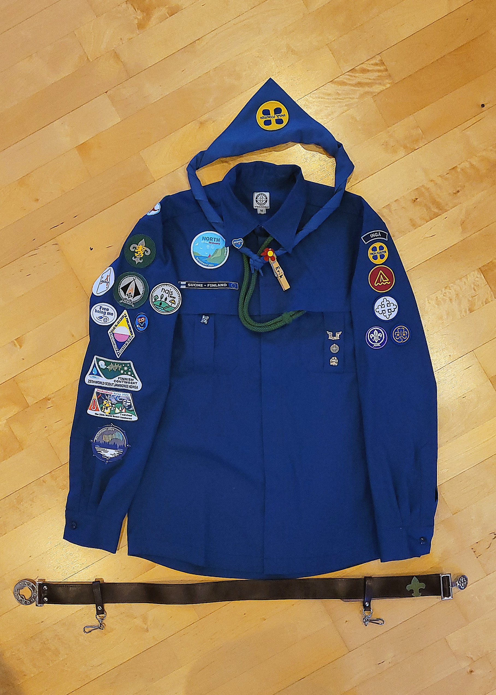
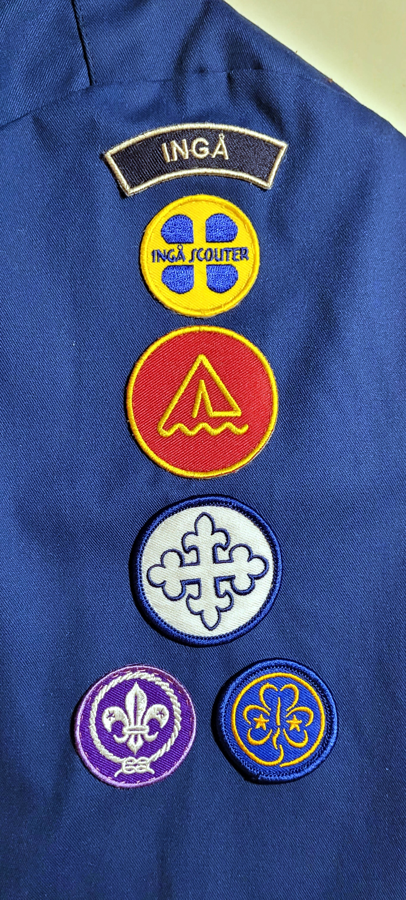
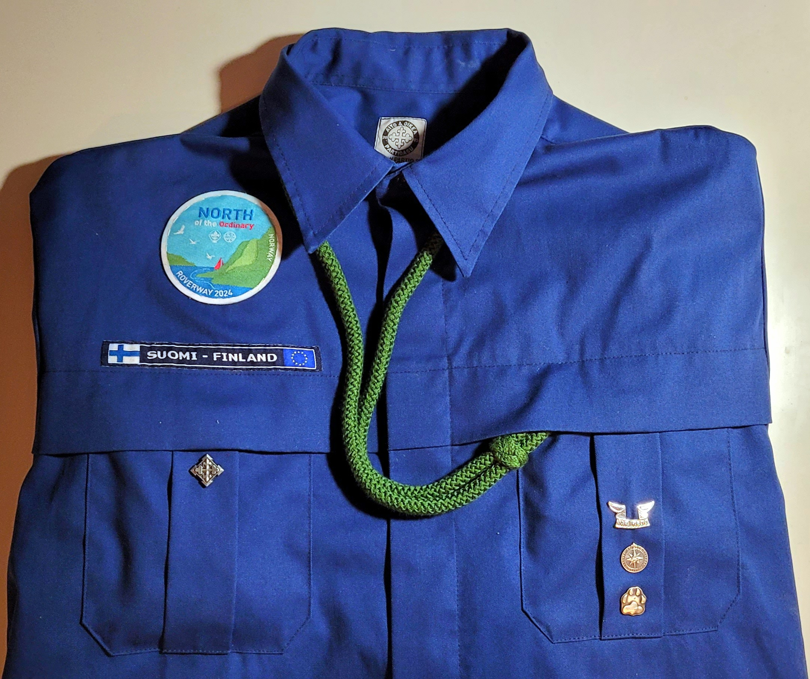

På den här sidan kan du få [allmän information](#general) om märken och läsa mer om [hur riggen ska se ut](#riggen).

## Allmän information {#general}

### Scouthalsduken

Scouthalsduken är en symbol för scouting och bärs av alla scouter. Den är en del av scoutdräkten och **används alltid inom scoutverksamheten** (förutom när man sover). Scouthalsduken varierar i färg och mönster från kår till kår. Ingå Scouter har en **helblå, med vår logga (som alla får 2 st. av) sydd ca 1 cm från kanten.**

_Visste du att man kallar scouter som inte har på sig sin scouthalsduk nakna?_

Scouthalsduken får man när man **som vargunge har avlagt välkommenspåret (eller blir kårmedlem senare)**. Den knyts ihop med en **[sjömansknop](https://sv.wikipedia.org/wiki/R%C3%A5bandsknop)**, eller en [vänskapsknop](https://en.wikipedia.org/wiki/Friendship_knot) av en vän.

### Märken

Märken får man då man då man avklarat kriterierna för märket. Dessa märken har namn, till exempel kallas **vargungarnas märken för spår**, spårmärke eller aktivitetsmärke.

### Sigill

När man blir **uppflyttad**, alltså går från en åldersgrupp till nästa, får man ett sigill. Sigillet ser olika ut, beroende på vilken åldersgrupp du avklarat.

### Rigg

Rigg är en term som används för att beskriva **scoutskjortan där alla märken sys fast och som man bär vid mer formella tillfällen**. Vanligtvis skaffar yngre scouter **inte** en rigg, utan istället använder de en mörkblå scoutcollege som finns tillgänglig för försäljning i vår webbutik.

* * *

## Hur riggen ska se ut {#riggen}

Nedan kommer information om var märken sys i allmänhet, samt guider för specifika åldersgrupper. Här är en bild du kan ta till hjälp, men **notera att tomtemärken borde placeras under åldersgruppsmärket**.

### Höger ärm

Åldersgruppsmärket sys högst upp på den högra ärmen. Under det kommer tomtemärken, evenemangsmärken och andra märken.

### Vänster ärm

På vänster arm sys märken i denna ordning, uppifrån och ner. Alla dessa märken får man av kåren.

1.  Ortsnamn (INGÅ)
2.  Kårmärke (litet Ingå Scouter märke)
3.  Förbundsmärke (FiSSc-märke)
4.  Organisationsmärke (FS-märke)
5.  Världsorganisationernas märken (WOSM & WAGGGS)

### Fickorna

I allmänhet finns uppdrags- och kursmärken på höger ficka under landsmärket. **Det senaste evenemangsmärket placeras ovanför landsmärket. Åldersgruppernas sigill fästs på vänster ficka, i åldersgruppsordning från fickans nedre kant uppåt.** Det är alltid rekommenderat att läsa och följa närmare instruktioner på [scout.fi](https://www.scout.fi/for-scouter/anvisningar/kladsel-och-marken/) för att vara säker på korrekt placering av märken.

### Visselpipor

Visselpipan hålls i riggens vänstra ficka när den bärs. Visselpipssnodden är grön för exlorerscouter, brun för roverscouter utan scoutledarfullmakt, blå för äldre ledare utan scoutledarfullmakt och vit för scoutledare med scoutledarfullmakt.

### Bälte

Till riggen hör också ett bälte, som hålls tomt ända tills man börjar samla liljor som explorerscout.

### Märkesguider

*   [Märkesguide för vargungar](https://www.scout.fi/wp-content/uploads/2019/02/kladsel_och_marken-vargunge.pdf)
*   [Märkesguide för äventyrsscouter](https://www.scout.fi/wp-content/uploads/2019/02/kladsel_och_marken-aventyrsscout-15.pdf)
*   [Märkesguide för spejarscouter](https://www.scout.fi/wp-content/uploads/2019/02/kladsel_och_marken-spejarscout-10.pdf)
*   [Märkesguide för explorerscouter](https://www.scout.fi/wp-content/uploads/2019/02/kladsel_och_marken-explorerscout-5.pdf)
*   [Märkesguide för roverscouter](https://www.scout.fi/wp-content/uploads/2019/02/kladsel_och_marken-roverscout.pdf)
*   [Märkesguide för äldre ledare](https://www.scout.fi/wp-content/uploads/2019/02/kladsel_och_marken-aldreledare.pdf)

För mera info, läs [klädsel och märken på scout.fi](https://www.scout.fi/for-scouter/anvisningar/kladsel-och-marken/)